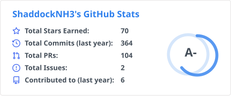

# Hi there, I'm ShaddockNH3 👋

Just a humble and obscure soul, dreaming of ascending to prominence while journeying along the path.

---

I'm a passionate learner and developer, always exploring new technologies and building cool things.

- 🧑‍💻 Name: ShaddockNH3
- 🎓 University: Fuzhou University
- 🏢 Organization: [West2Online](https://github.com/west2-online)
- 🌱 I’m currently learning: AI, Golang
- ✨ Blog: [Attilio Blog](https://blog.attilio.cc/)
- 📫 How to reach me: shaddock1122@163.com

---
### 📊 GitHub Situation

<!-- 卡片由 .github/workflows/profile-cards.yml 每天自动生成并提交，数据源是自己仓库里的 SVG，不依赖任何第三方接口 -->

  <picture>
    <source media="(prefers-color-scheme: dark)"
      srcset="https://raw.githubusercontent.com/ShaddockNH3/ShaddockNH3/main/profile-summary-card-output/github_dark/0-profile-details.svg" />
    <source media="(prefers-color-scheme: light)"
      srcset="https://raw.githubusercontent.com/ShaddockNH3/ShaddockNH3/main/profile-summary-card-output/github/0-profile-details.svg" />
    
  </picture>

  <picture>
    <source media="(prefers-color-scheme: dark)"
      srcset="https://raw.githubusercontent.com/ShaddockNH3/ShaddockNH3/main/profile-summary-card-output/stats/stats-dark.svg" />
    <source media="(prefers-color-scheme: light)"
      srcset="https://raw.githubusercontent.com/ShaddockNH3/ShaddockNH3/main/profile-summary-card-output/stats/stats-light.svg" />
    
  </picture>

  <picture>
    <source media="(prefers-color-scheme: dark)"
      srcset="https://raw.githubusercontent.com/ShaddockNH3/ShaddockNH3/main/profile-summary-card-output/github_dark/1-repos-per-language.svg" />
    <source media="(prefers-color-scheme: light)"
      srcset="https://raw.githubusercontent.com/ShaddockNH3/ShaddockNH3/main/profile-summary-card-output/github/1-repos-per-language.svg" />
    
  </picture><picture>
    <source media="(prefers-color-scheme: dark)"
      srcset="https://raw.githubusercontent.com/ShaddockNH3/ShaddockNH3/main/profile-summary-card-output/github_dark/4-productive-time.svg" />
    <source media="(prefers-color-scheme: light)"
      srcset="https://raw.githubusercontent.com/ShaddockNH3/ShaddockNH3/main/profile-summary-card-output/github/4-productive-time.svg" />
    
  </picture>

